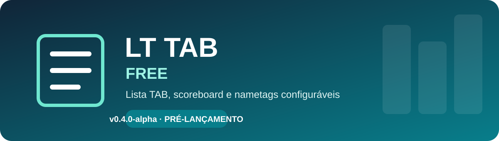

# LT Tab Free

**Personalize a lista TAB, scoreboard e nametags**

**[⬇ Baixar JAR](https://github.com/leozituDev/LT-PLUGIN-RELEASES/raw/refs/heads/main/plugins/LT-Tab/0.4.0-alpha/LTTab-Free-0.4.0-alpha.jar)** · **[SHA-256](0.4.0-alpha/SHA256SUMS.txt)** · **[Histórico](CHANGELOG.md)** · **[Reportar problema](../../issues/new/choose)**

---

## Sobre

O LT Tab Free configura cabeçalho e rodapé, formato dos nomes, scoreboard individual, prefixos e sufixos das nametags e grupos visuais por permissão.

> **Pré-lançamento Alpha:** a compilação tem como alvo Paper 26.3 build 227 e Java 25. Validação visual em jogo ainda está pendente; compatibilidade com Spigot, Purpur e Bedrock/Geyser não foi confirmada. Faça backup da configuração e teste antes de usar em produção.

## Informações

| Item | Valor |
| --- | --- |
| Versão | `0.4.0-alpha` |
| Edição | Free |
| Nome interno | `LTTab` |
| API declarada | `26.3` |
| Comando | `/lttab` (atalho `/tablt`) |
| Permissão administrativa | `lttab.admin` |
| Integrações opcionais | LTClans, LTEconomy, LTRankUp, LTVip, Moderação e PlaceholderAPI |

A integração com os plugins listados é opcional. O servidor inicia sem eles. Instale somente uma edição do LT Tab por servidor; Free e Pro compartilham o identificador `LTTab`.

## Instalação

1. Faça backup de `plugins/LTTab/config.yml`.
2. Baixe o [JAR LT Tab Free 0.4.0-alpha](https://github.com/leozituDev/LT-PLUGIN-RELEASES/raw/refs/heads/main/plugins/LT-Tab/0.4.0-alpha/LTTab-Free-0.4.0-alpha.jar).
3. Coloque-o na pasta `plugins/` e reinicie o Paper.
4. Configure `plugins/LTTab/config.yml` e use `/lttab ajuda`.

## English

LT Tab Free configures the player list, sidebar scoreboard, nametags and permission-based visual groups. Version `0.4.0-alpha` targets Paper 26.3 and Java 25. This Alpha has not been visually validated in game or confirmed on Spigot, Purpur or Bedrock/Geyser.

**[Download JAR](https://github.com/leozituDev/LT-PLUGIN-RELEASES/raw/refs/heads/main/plugins/LT-Tab/0.4.0-alpha/LTTab-Free-0.4.0-alpha.jar)** · **[Changelog](CHANGELOG.md)**
